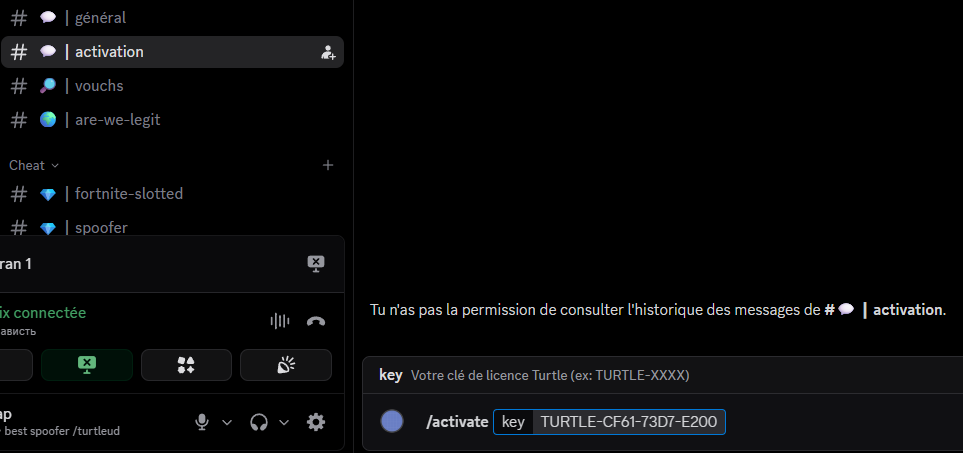
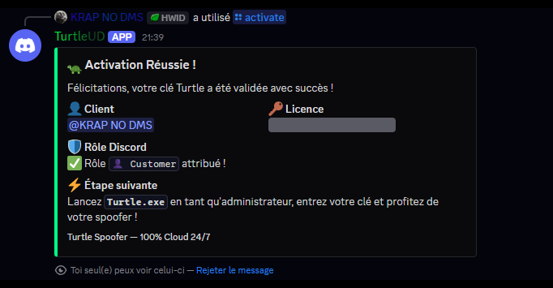
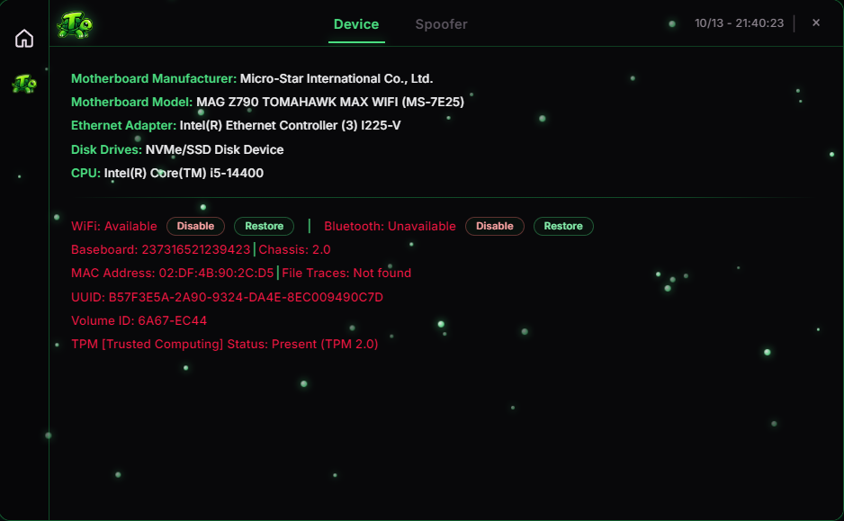
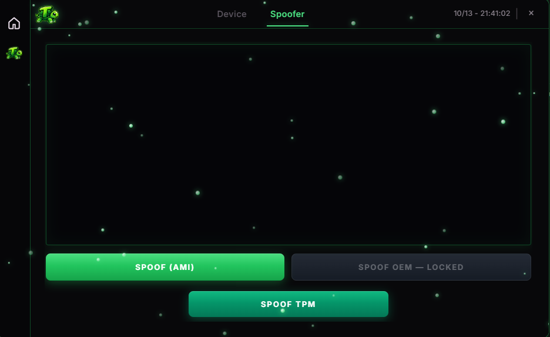
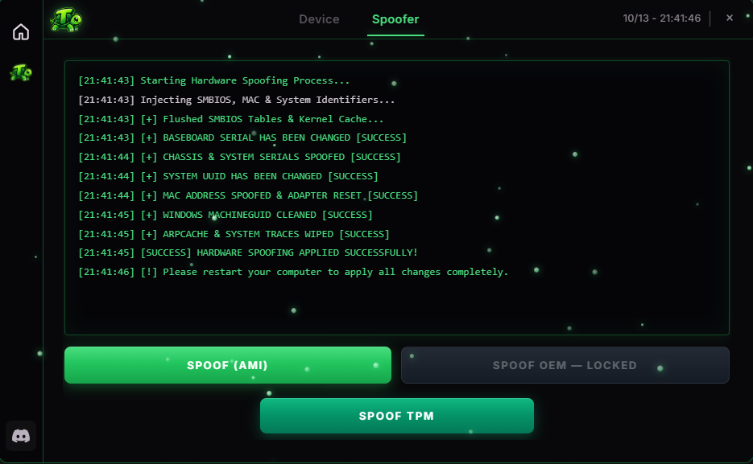

# Step 7 – Run Turtle Spoofer

This step guides you through logging into **Turtle Spoofer**, activating your license via Discord, and applying the hardware spoof.




## 1. Open the Application

Launch **`Turtle.exe`** as **Administrator** (right-click > *Run as administrator*).

<figure><figcaption>Turtle V1 Login Interface</figcaption></figure>





## 2. Enter License Key

Paste your license key received upon purchase into the input field, then click **LOGIN**.

<figure><figcaption>Entering Turtle Key</figcaption></figure>





## 3. Discord Activation Required

If your key is not activated yet, you will see:  
`Please activate your license first on our official Discord using /activate !`

<figure><figcaption>Discord Activation Required</figcaption></figure>





## 4. Activate License in #activation Channel

1. Join our official Discord server and head to the **`# 💬 | activation`** channel.
2. Use the slash command:
   ```text
   /activate key: YOUR_KEY
   ```
3. Submit the command.

<figure><figcaption>Discord Activation Channel</figcaption></figure>





## 5. Activation Confirmation

The **TurtleUD** bot will confirm activation immediately:
* ✅ **Role `Customer` assigned!**
* Status: **Activation Successful!**

<figure><figcaption>Bot Confirmation</figcaption></figure>





## 6. Login to Spoofer & Take Screenshot

Return to **Turtle V1**, click **LOGIN**. You will see the **Device** tab with all your current hardware identifiers.

<figure><figcaption>Device Tab: Hardware Identifiers Before Spoofing</figcaption></figure>


Take a photo or screenshot of this screen to compare your serial numbers after spoofing!






## 7. Apply the Spoof

1. Click on the **Spoofer** tab in the top navigation bar.
2. Click the green **SPOOF (AMI)** button.

<figure><figcaption>Turtle Spoofer Menu</figcaption></figure>





## 8. Success & Restart PC

The spoofer will randomize your serials and display success logs:
* `[+] BASEBOARD SERIAL HAS BEEN CHANGED [SUCCESS]`
* `[+] CHASSIS & SYSTEM SERIALS SPOOFED [SUCCESS]`
* `[+] SYSTEM UUID HAS BEEN CHANGED [SUCCESS]`
* `[+] MAC ADDRESS SPOOFED & ADAPTER RESET [SUCCESS]`
* `[SUCCESS] HARDWARE SPOOFING APPLIED SUCCESSFULLY!`

<figure><figcaption>Spoofing Applied Successfully</figcaption></figure>


**MANDATORY:** Restart your computer now to let Windows apply all new hardware identifiers!




